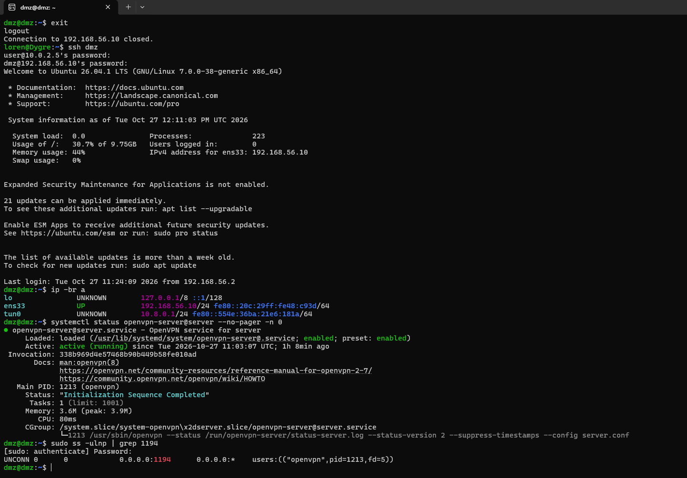
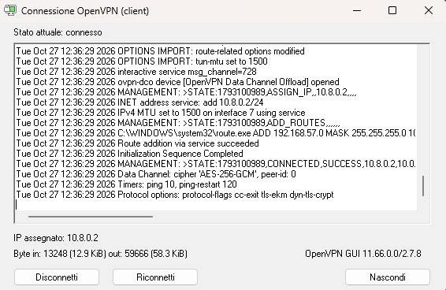
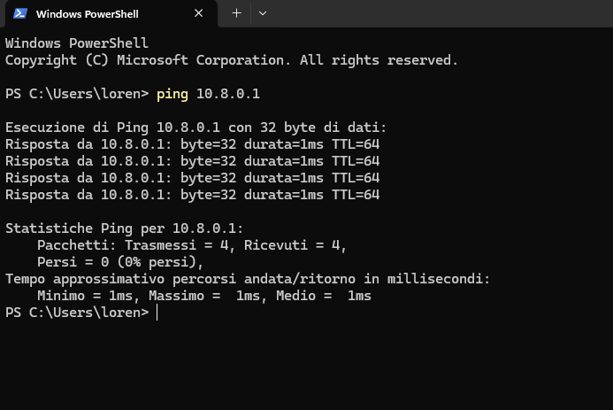

# DMZ: server OpenVPN

La DMZ ospita `DMZ_VPN`, un server OpenVPN raggiungibile dall'esterno attraverso il DNAT del firewall.

| Parametro | Valore |
|---|---|
| Rete | VMnet1, `192.168.56.0/24` |
| Indirizzo | `192.168.56.10/24` |
| Gateway | `192.168.56.2` (firewall) |
| Rete del tunnel | `10.8.0.0/24`, server `10.8.0.1` (`tun0`) |
| Porta | UDP 1194 |
| Servizio | `openvpn-server@server` |

Il gateway deve essere il firewall: le risposte della VPN devono tornare indietro dallo stesso percorso da cui sono arrivate.

## Server

Sulla macchina sono presenti in `/etc/openvpn/server/`: `ca.crt`, `server.crt`, `server.key` e `server.conf`.

Verifica dello stato:

```
ip -br a
systemctl status openvpn-server@server --no-pager -n 0
sudo ss -ulnp | grep 1194
```

- `ip -br a` mostra `ens33` con `192.168.56.10` e `tun0` con `10.8.0.1`.
- `systemctl status` deve riportare `active (running)`.
- `ss -ulnp` mostra OpenVPN in ascolto sulla UDP 1194.



## Percorso del traffico

```
PC fisico → UDP 1194 → firewall 10.0.2.5 → DNAT → 192.168.56.10:1194
```

Il client si collega direttamente a `10.0.2.5`, l'indirizzo del firewall sulla rete NAT.

## Client Windows

Sul PC fisico è installato OpenVPN Community. Nella cartella di configurazione del client ci sono la CA, il certificato e la chiave del client, più un file `client.ovpn`:

```
client
dev tun
proto udp
remote 10.0.2.5 1194
resolv-retry infinite
nobind
remote-cert-tls server
ca ca.crt
cert client1.crt
key client1.key
verb 3
```

Prima di usare il certificato ho verificato che:

- il certificato del client sia firmato dalla stessa CA del server (confronto delle impronte SHA-256 delle due `ca.crt`);
- la chiave privata corrisponda al certificato (confronto dell'impronta della chiave pubblica).

### Primo tentativo con `127.0.0.1`

Con `remote 127.0.0.1 1194` la connessione restava in `WAIT` e non arrivava mai alla fase TLS: dall'host verso sé stesso il port forwarding UDP di VMware non inoltra il traffico. Il PC è già sulla rete VMnet8 (`10.0.2.1`) e raggiunge direttamente il firewall su `10.0.2.5`, quindi la soluzione è stata puntare a quell'indirizzo.

## Connessione riuscita

Il log del client mostra l'assegnazione di `10.8.0.2`, la rotta verso la LAN spinta dal server e `Initialization Sequence Completed`.



Verifica del tunnel da PowerShell:

```
ping 10.8.0.1
```



## Limiti noti

- Il server spinge al client la rotta verso `192.168.57.0/24`, ma il ping verso `192.168.57.10` non risponde: sul firewall manca la regola di `FORWARD` da `ens37` verso `ens38`. La VPN funziona, l'accesso alla LAN dal tunnel non è ancora aperto.
- La macchina non ha accesso a internet perché sul firewall non c'è il `MASQUERADE`.
