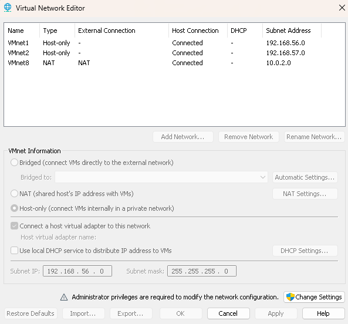
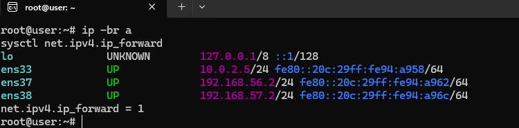
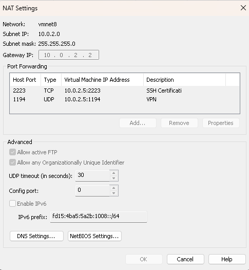
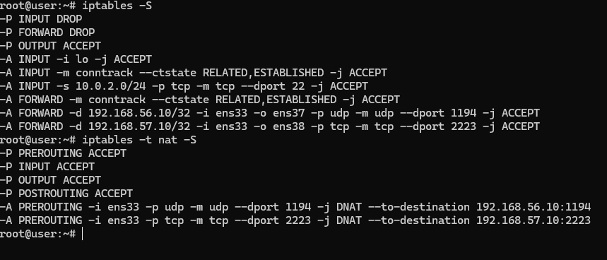

# Firewall

Il firewall è una VM Ubuntu con tre schede di rete. Fa da router tra WAN, DMZ e LAN e filtra il traffico con iptables.

## Reti VMware

| Rete | Tipo | Subnet | Ruolo | Interfaccia firewall |
|---|---|---|---|---|
| VMnet8 | NAT | `10.0.2.0/24` | WAN | `ens33` → `10.0.2.5` |
| VMnet1 | Host-only | `192.168.56.0/24` | DMZ | `ens37` → `192.168.56.2` |
| VMnet2 | Host-only | `192.168.57.0/24` | LAN | `ens38` → `192.168.57.2` |

Il DHCP è disattivato su tutte e tre le reti. Il gateway della NAT è `10.0.2.2`.



## Indirizzi statici (netplan)

`ens33` non riceve un indirizzo automatico perché il DHCP di VMnet8 è spento, quindi è configurata a mano in `/etc/netplan/`:

```yaml
network:
  version: 2
  ethernets:
    ens33:
      dhcp4: false
      addresses: [10.0.2.5/24]
      routes:
        - to: default
          via: 10.0.2.2
      nameservers:
        addresses: [10.0.2.2, 8.8.8.8]
    ens37:
      dhcp4: false
      addresses: [192.168.56.2/24]
    ens38:
      dhcp4: false
      addresses: [192.168.57.2/24]
```

Applicata in sicurezza con `netplan try`, che annulla la modifica dopo 120 secondi se non viene confermata.



## Port forwarding VMware

Il port forwarding è configurato su VMnet8 (NAT Settings) e porta il traffico del PC fisico fino al firewall:

| Porta host | Tipo | Destinazione | Servizio |
|---|---|---|---|
| 1194 | UDP | `10.0.2.5:1194` | OpenVPN |
| 2223 | TCP | `10.0.2.5:2223` | SSH con certificati |



Il port forwarding di VMware arriva solo fino al firewall: la destinazione finale è decisa dal DNAT di iptables.

## Regole iptables

Politica predefinita: `INPUT` e `FORWARD` in `DROP`, `OUTPUT` in `ACCEPT`.

Le regole principali:

- **INPUT**: traffico locale e connessioni già stabilite, più SSH (porta 22) ammesso dalla rete `10.0.2.0/24` per amministrare il firewall.
- **DNAT** (tabella `nat`, `PREROUTING`):
  - UDP 1194 su `ens33` → `192.168.56.10:1194` (OpenVPN in DMZ)
  - TCP 2223 su `ens33` → `192.168.57.10:2223` (SSH in LAN)
- **FORWARD**: accetta solo il traffico verso quelle due destinazioni, più le risposte (`RELATED,ESTABLISHED`).

Esempio delle regole della porta SSH:

```
iptables -t nat -A PREROUTING -i ens33 -p tcp --dport 2223 -j DNAT --to-destination 192.168.57.10:2223
iptables -A FORWARD -i ens33 -o ens38 -d 192.168.57.10 -p tcp --dport 2223 -j ACCEPT
```

Il DNAT riscrive la destinazione prima dell'instradamento, ma con `FORWARD` in `DROP` serve anche la regola che lascia passare il pacchetto.

Le regole sono rese persistenti con:

```
netfilter-persistent save
```

e salvate in `/etc/iptables/rules.v4`.



## Verifica

Dal firewall:

- `ping` verso `192.168.56.10` (DMZ) e `192.168.57.10` (LAN) con 0% di perdita.
- `ping` verso `8.8.8.8` e `google.com`: il firewall esce su internet dalla NAT.

## Limiti noti

- Manca la regola di `FORWARD` da `ens37` verso `ens38`: la DMZ e i client VPN non raggiungono la LAN.
- Manca il `MASQUERADE`: DMZ e LAN non hanno accesso a internet.
