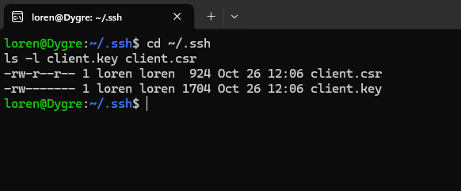
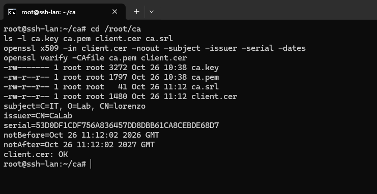
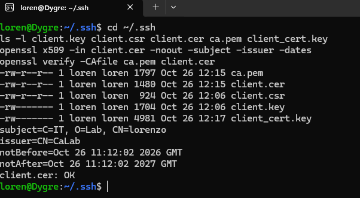
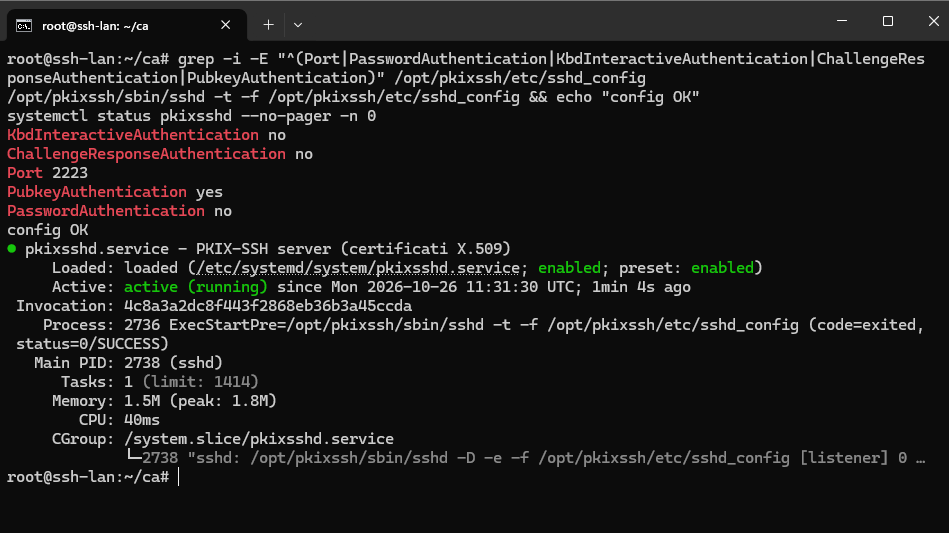
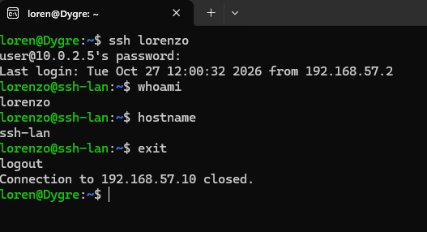
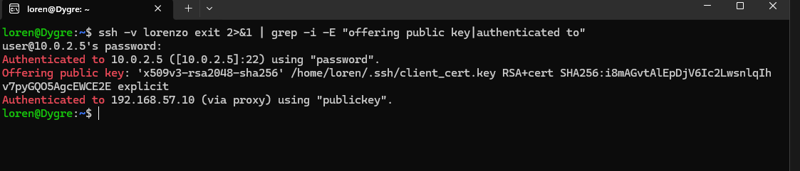
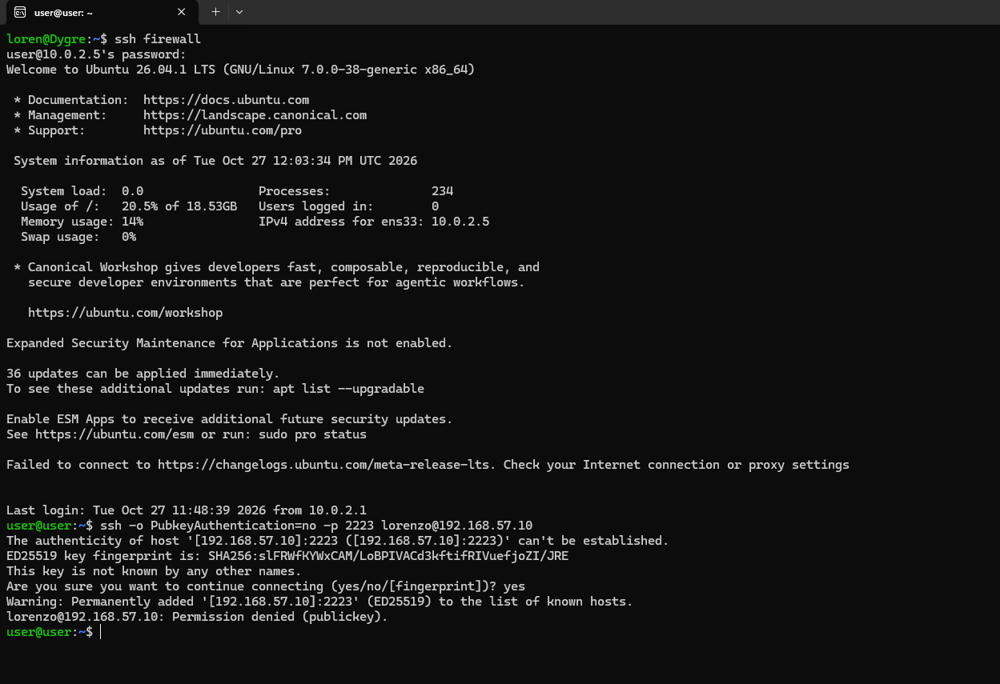

# SSH con certificati X.509

Accesso al server `ssh-lan` solo con **certificato**, senza password. Il server si fida di una CA privata (`CaLab`) creata con OpenSSL: entra solo chi presenta un certificato firmato da quella CA e presente in `authorized_keys`.

| Parametro | Valore |
|---|---|
| Server | `ssh-lan`, `192.168.57.10` |
| Porta | 2223 (PKIX-SSH in `/opt/pkixssh`) |
| Client | PC fisico, Ubuntu su WSL con PKIX-SSH |
| CA | `CaLab`, RSA 4096, validità 10 anni |
| Certificato client | RSA 2048, validità 365 giorni |

L'OpenSSH nativo di Windows non gestisce i certificati X.509, per questo il client è PKIX-SSH compilato dentro WSL.

## Schema

1. Il server genera la CA e tiene `ca.key` riservata.
2. Il client genera sul proprio PC chiave privata e richiesta di certificato (CSR). **La chiave privata non lascia il PC.**
3. La CA firma la CSR e restituisce il certificato.
4. Il client unisce chiave, certificato e CA in un unico file di identità.
5. Il server accetta il certificato tramite `authorized_keys`.

## 1. CA sul server

```
mkdir -p /root/ca && chmod 700 /root/ca && cd /root/ca
openssl genrsa -out ca.key 4096
chmod 600 ca.key
openssl req -x509 -new -nodes -key ca.key -sha256 -days 3650 -subj "/CN=CaLab" -out ca.pem
cp ca.pem /opt/pkixssh/etc/ca.pem
```

La chiave della CA è leggibile solo da root: chi la possiede può emettere certificati validi.

## 2. Chiave e richiesta sul client (WSL)

```
mkdir -p ~/.ssh && cd ~/.ssh
openssl req -new -newkey rsa:2048 -nodes -keyout client.key -out client.csr -subj "/C=IT/O=Lab/CN=lorenzo"
chmod 600 client.key
```

Al server viene inviata solo la CSR.



## 3. Firma del certificato

```
openssl x509 -req -in /home/dmz/client.csr -CA ca.pem -CAkey ca.key -CAcreateserial -out client.cer -days 365 -sha256 -extfile <(printf "basicConstraints=CA:FALSE")
openssl verify -CAfile ca.pem client.cer
```

`CA:FALSE` impedisce che il certificato del client possa firmarne altri. La verifica deve rispondere `client.cer: OK`.



## 4. Identità sul client

```
cd ~/.ssh
openssl verify -CAfile ca.pem client.cer
cat client.key client.cer ca.pem > client_cert.key
chmod 600 client_cert.key
```

PKIX-SSH richiede in un solo file la chiave privata, il certificato e la CA, in quest'ordine.



Configurazione del client in `~/.ssh/config`, con accesso attraverso il firewall:

```
Host firewall
    HostName 10.0.2.5
    User <utente>

Host lorenzo
    HostName 192.168.57.10
    Port 2223
    User lorenzo
    IdentityFile ~/.ssh/client_cert.key
    IdentitiesOnly yes
    ProxyJump firewall
```

`ProxyJump` apre prima la connessione verso il firewall e fa passare dentro quel tunnel quella verso `ssh-lan`.

## 5. Autorizzazione sul server

Dal certificato si ricava la riga pubblica con `ssh-keygen -y -f ~/.ssh/client_cert.key`, che viene copiata nel file `authorized_keys` dell'utente.

```
chown -R lorenzo:lorenzo /home/lorenzo/.ssh
chmod 700 /home/lorenzo/.ssh
chmod 600 /home/lorenzo/.ssh/authorized_keys
chmod go-w /home/lorenzo
```

I permessi stretti sono richiesti da sshd, che altrimenti ignora il file.

## 6. Configurazione di sshd

In `/opt/pkixssh/etc/sshd_config`:

```
Port 2223
PubkeyAuthentication yes
PasswordAuthentication no
KbdInteractiveAuthentication no
ChallengeResponseAuthentication no
```

`/opt/pkixssh/sbin/sshd -t -f /opt/pkixssh/etc/sshd_config` controlla la sintassi, poi il servizio parte con `systemctl enable --now pkixsshd`.



## 7. Login con certificato

Dal WSL, passando dal firewall:

```
ssh lorenzo
whoami && hostname
```

Nessuna password richiesta: il login avviene con il certificato.



Prova del metodo di autenticazione:

```
ssh -v lorenzo exit 2>&1 | grep -i -E "offering public key|authenticated to"
```

Compaiono l'offerta del certificato `x509v3-rsa2048-sha256` e `Authenticated to ... using "publickey"` verso `ssh-lan` (la prima riga verso il firewall è la connessione di salto).



## 8. Password rifiutata

Dal firewall, forzando un tentativo senza certificato:

```
ssh -o PubkeyAuthentication=no -p 2223 lorenzo@192.168.57.10
```

Risposta: `Permission denied (publickey)`, senza nessuna richiesta di password.



## Problemi incontrati

| Problema | Causa | Soluzione |
|---|---|---|
| `Permission denied (publickey,keyboard-interactive)` | `PasswordAuthentication no` non basta: il metodo `keyboard-interactive` restava attivo per default | Aggiunte `KbdInteractiveAuthentication no` e `ChallengeResponseAuthentication no` in cima a `sshd_config` |
| `cert_line.pub` di 0 byte | Il file `client_cert.key` non era stato creato | Ricreato con `cat client.key client.cer ca.pem` e rigenerata la riga pubblica |
| `No route to host` | Indirizzo del server sbagliato nella configurazione | Corretto l'IP; poi il server è stato spostato nella LAN dietro il firewall |
| Firma su una CSR sbagliata | Sul server c'era una CSR residua di un tentativo precedente, con modulo diverso | Confronto dell'impronta del modulo (`-modulus \| md5sum`) e nuovo invio della CSR giusta |
| Chiave privata residua sul server | Generata per errore in `/root/.ssh` | Eliminata con `shred -u` |

## Note di sicurezza

- Il certificato scade dopo 365 giorni: per rinnovarlo basta firmare di nuovo la CSR.
- `ca.key` va conservata in un backup sicuro: senza, la CA va ricreata da capo.
- Nel repository non ci sono chiavi né certificati.
